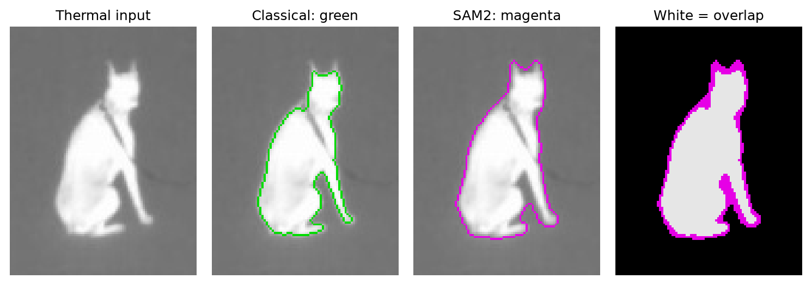

# Module 4: Thermal animal boundaries

**Aya Abdelkarem | CSc 8830, Computer Vision | Spring 2026**

This project extracts a dog's boundary from a real thermal image using classical OpenCV operations and compares the result with an actual, independent SAM2 prediction.

## Deliverables

- [PDF report](Module_4_Report.pdf): algorithm, full-image input, enlarged boundaries, executed numerical comparison, limitations and repository link.
- [Working demonstration](Module_4_Working_Demo.mp4): captioned outputs from a fresh classical extraction and SAM2 inference.
- [Main source](module4.py), [recording code](record_demo.py), and [report generator](make_report.py).
- [Classical boundary coordinates](classical_boundary_xy.csv), both binary masks, [comparison metrics](comparison_metrics.json), and [raw SAM2 prediction](sam2_raw_prediction.npz).

The PDF and video are prepared for manual attachment to Week 4 / Module 4 in Google Classroom. **No Classroom submission is performed by any script.**

## Actual results

| Quantity | Result |
|---|---:|
| Original image | 640 × 512 pixels |
| Classical Otsu threshold | 176 / 255 |
| Classical foreground | 2,109 pixels |
| Classical boundary vertices | 247 |
| SAM2 foreground | 2,663 pixels |
| Intersection / union | 2,109 / 2,663 pixels |
| Mask IoU agreement | 0.791964 (79.20%) |
| Dice agreement | 0.883906 (88.39%) |
| Mean symmetric boundary distance | 2.168 pixels |
| Symmetric 95th-percentile Hausdorff distance | 7.000 pixels |
| Boundary F1 within 2 pixels | 0.686908 |



Green denotes the classical method; magenta denotes SAM2. In the final panel, white is shared foreground. The classical mask is contained within SAM2's mask; SAM2 includes 554 additional pixels. Differences occur near dimmer outer details, including the ears, neck and legs.

**These are agreement metrics, not ground-truth accuracy.** No reference segmentation establishes a pixel-exact animal silhouette. The CSV provides the complete discrete external contour of the estimated classical mask. SAM2's predicted IoU score (0.9098) is also a model estimate, not an observed accuracy measurement.

## The primary method uses no machine learning

The fixed manual ROI is `[270,225,340,335]` in `x0,y0,x1,y1` coordinates; the crop is half-open. The foreground seed is `(301,284)` in `x,y` coordinates. These inputs and the primary algorithm were established before the SAM2 run.

1. Convert the image to grayscale and crop the ROI.
2. Smooth with a 5 × 5 Gaussian.
3. Apply Otsu thresholding using white-hot polarity.
4. Open and then close with a 3 × 3 elliptical kernel.
5. Retain the connected component containing the foreground seed.
6. Restore full-image coordinates and extract the external contour with `CHAIN_APPROX_NONE`.

The primary branch uses only NumPy/OpenCV and does not import PyTorch or SAM2. It saves its result before the comparator is run. The SAM2 branch uses the original full image and the same box, with no classical mask, contour, threshold or seed. Comparison checks ensure the comparator does not change the primary mask. SAM2 is not used to choose or refine the classical boundary.

## Reproduce the primary result

Download with **Code → Download ZIP** and extract the files. Use a terminal inside that directory. Python 3.10 or later is recommended for the complete project.

```bash
python -m venv .venv
```

Activate the virtual environment (`source .venv/bin/activate` on macOS/Linux, or `.venv\Scripts\activate` on Windows), then:

```bash
python -m pip install -r requirements.txt
python module4.py classical
```

This command requires no model checkpoint and produces the classical mask, overlay, coordinates and metrics. The original public dataset photograph is included unchanged as `thermal_dog.jpeg`.

## Reproduce SAM2, comparison, video and report

```bash
python install_sam2.py
python module4.py all
python record_demo.py
python make_report.py
```

`install_sam2.py` installs PyTorch/TorchVision and the official Meta SAM2 code pinned to commit `2b90b9f5ceec907a1c18123530e92e794ad901a4`. A working Git installation and initial network access are required for installation. The optional CUDA extension is disabled; this project uses CPU inference.

The first full run automatically downloads the official **156 MB SAM2.1 Hiera Tiny checkpoint** and verifies SHA-256:

```text
7402e0d864fa82708a20fbd15bc84245c2f26dff0eb43a4b5b93452deb34be69
```

The checkpoint is not stored in this Git repository. It is downloaded from the [official Meta checkpoint URL](https://dl.fbaipublicfiles.com/segment_anything_2/092824/sam2.1_hiera_tiny.pt), not from an invented or substituted prediction. After installation/download, local runs need no network access.

To use an existing matching checkpoint:

```bash
python module4.py all --checkpoint /path/to/sam2.1_hiera_tiny.pt
python record_demo.py --checkpoint /path/to/sam2.1_hiera_tiny.pt
```

To display the working application as it records:

```bash
python record_demo.py --show
```

Press Escape to stop. The MP4 records actual application-rendered outputs with timed reading holds; it is not an OS desktop screen capture and has no audio or claimed student narration. Both algorithms execute again during recording. The supplied completed recording is 65 seconds, 1280 × 720 at 20 fps, with every frame decoded for validation.

To inspect included results without downloading SAM2 again:

```bash
python module4.py compare
python make_report.py
```

This verifies the saved image/mask hashes and recomputes agreement from the included masks. It does **not** pretend to rerun the model. Full inference is the `all` or `sam2` command.

## Model and validation details

SAM2 configuration: `configs/sam2.1/sam2.1_hiera_t.yaml`; CPU float32; four threads; box-only prompt; `multimask_output=False`; standard dynamic stability fallback enabled; no hole/sprinkle cleanup. Exact settings and checkpoint/input hashes appear in [sam2_metrics.json](sam2_metrics.json). The raw output mask, scores and low-resolution logits are preserved in `sam2_raw_prediction.npz`.

The code checks matching image hashes, identical ROI/box, valid mask checksums and dimensions, foreground seed membership, one classical contour, an unchanged classical mask after SAM2, hand-verifiable overlap formulas, and zero distances/unit boundary F1 for identical masks. The video verifies that its fresh computation reproduces the saved intersection, union, IoU and Dice.

Boundary distances use Euclidean distance transforms on one-pixel external contours. Mean symmetric distance averages the two directed means; symmetric HD95 is the larger of the two directed 95th percentiles. Boundary F1 uses a two-pixel distance tolerance in both directions.

The threshold sweep is recorded in [classical_metrics.json](classical_metrics.json). It perturbs Otsu's threshold by −20, −10, 0, +10 and +20 solely to show sensitivity. The submitted primary output remains Otsu's automatically selected threshold. Timing values are individual execution samples, not a benchmark. Exact package versions appear in [TESTED_ENVIRONMENT.json](TESTED_ENVIRONMENT.json).

`FILE_SHA256.json` describes the published snapshot. Regeneration can change timings, PDF metadata, file hashes and tiny floating-point details. Binary mask hash checks compare the masks to their paired regenerated metadata.

## Provenance and limitations

The real FLIR A65 image comes from [sensationTI/FLIR_IR_Expansion](https://github.com/sensationTI/FLIR_IR_Expansion), original file `misc/FLIR_08863.jpeg`. See [image attribution](IMAGE_ATTRIBUTION.md), [source image repository license](IMAGE_LICENSE.txt), and [SAM2 license](SAM2_LICENSE.txt).

The manual ROI and seed make this a segmentation experiment on a selected animal, not a general animal detector. Thermal brightness is not converted into temperature. No physical animal area, pixel-perfect ground truth, broad dataset performance or grade is claimed. Thresholding can lose thin/dim regions and merge touching warm objects; SAM2 can also fail on unfamiliar thermal content.

Review the implementation and results before submission. No student capture, voice, attendance or submission is invented.

## References

- [Module 4 assignment](https://docs.google.com/document/d/1HTuvFDvvbDXWJSi9XztM3WnG6kZDAs-iY63GTgmDjsM/edit)
- [Meta SAM2 repository and image predictor](https://github.com/facebookresearch/sam2)
- [OpenCV thresholding](https://docs.opencv.org/4.x/d7/d4d/tutorial_py_thresholding.html) and [morphology](https://docs.opencv.org/4.x/d9/d61/tutorial_py_morphological_ops.html)
